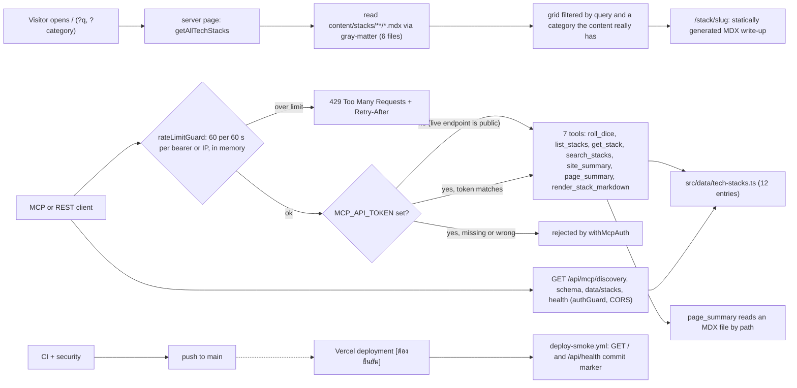
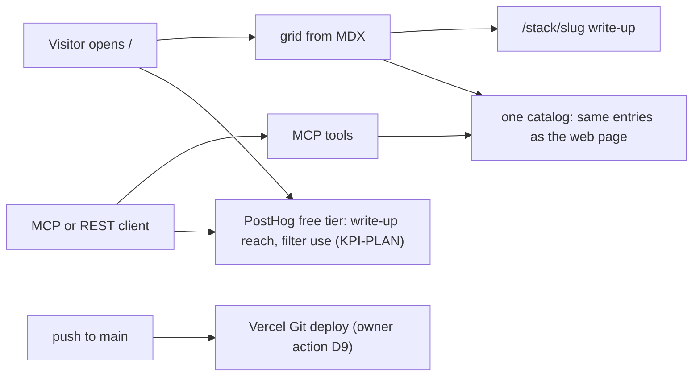

# 01 — Business process (As-Is / To-Be)

portfolio-techspace-web (TechSpace) คือแค็ตตาล็อกเครื่องมือและเฟรมเวิร์กที่เจ้าของใช้จริง บนเว็บ Next.js ผู้เยี่ยมชมค้นหา/กรองตามหมวดแล้วอ่านบันทึก MDX ของแต่ละ stack และ client อื่นเรียกข้อมูลผ่าน MCP server (`/api/mcp`) กับ REST companion ได้ โดยไม่มีบัญชีผู้ใช้และไม่มีฐานข้อมูล

Last reviewed: 2026-11-28 · commit `6512730`

## As-Is (จากโค้ดวันนี้)

Sources: `src/app/page.tsx`, `src/lib/mdx.ts`, `src/app/stack/[slug]/page.tsx`, `src/app/api/mcp/route.ts`, `src/lib/mcp/tools.ts`, `src/lib/mcp/rateLimiter.ts`, `src/lib/mcp/controllers.ts`, `src/app/api/mcp/discovery/route.ts`, `src/app/api/mcp/data/stacks/route.ts`, `src/app/api/health/route.ts`, `.github/workflows/deploy-smoke.yml`, `scripts/deploy-smoke.sh`, `PRODUCT.md`

ข้อเท็จจริงจากโค้ด:

- หน้าเว็บอ่านบันทึกจากไฟล์ MDX (6 รายการ) แต่ MCP และ REST อ่านจาก `src/data/tech-stacks.ts` (12 รายการ) สองพื้นผิวจึงแสดงแค็ตตาล็อกไม่ตรงกัน (ตรงกับที่ `PRODUCT.md` ระบุ)
- rate limiter เก็บใน memory ของ instance เดียว (Map); ผลบน Vercel หลาย instance [ต้องยืนยัน]
- `PRODUCT.md` (2026-10-22/23) ว่า Git link ของ Vercel ชี้ repo เก่าและ push ไม่ deploy แต่ workflow `deploy-smoke.yml` ถูกออกแบบให้รันเมื่อ Vercel Git deploy สำเร็จ; สถานะวันนี้ [ต้องยืนยัน]
- ไม่มี product analytics; Sentry (errors only) เมื่อมี DSN ตั้งบน Vercel จริงหรือไม่ [ต้องยืนยัน]

## To-Be (docs/measurement/KPI-PLAN.md และ PRODUCT.md)

Sources: `docs/measurement/KPI-PLAN.md` (KPI-O-01, KPI-L-01, KPI-L-02; owner decision D4), `PRODUCT.md` §What it does not do, §Live and deploy state

## Gap

| ID | As-Is → To-Be | Status | Owner | Evidence |
|---|---|---|---|---|
| G1 | เว็บอ่าน MDX 6 รายการ แต่ MCP/REST อ่าน `tech-stacks.ts` 12 รายการ → แค็ตตาล็อกเดียวกันทั้งสองพื้นผิว (PRODUCT.md ระบุว่าเป็นความไม่ตรงกัน) | todo | claude | `PRODUCT.md` §What it does not do; `src/lib/mcp/tools.ts` |
| G2 | ไม่มี product analytics → PostHog ตามข้อกำหนด KPI (D4) ซึ่งยังไม่มี account หรือ key | blocked | owner | `docs/measurement/KPI-PLAN.md`; `PRODUCT.md` (ไม่มี PostHog account) |
| G3 | push ไป main ไม่ deploy (Vercel Git link ชี้ repo เก่า ตาม PRODUCT.md) → Vercel Git deploy (D9) | decide | owner | `PRODUCT.md` §Live and deploy state [ต้องยืนยัน] |
| G4 | deploy smoke ตรวจ `/` ก่อนรอ commit marker จึงอาจตรวจ deployment เก่าช่วง alias ย้าย → ตรวจ marker ก่อน | todo | claude | `PRODUCT.md` §Known limits; `scripts/deploy-smoke.sh` |

## Open questions

- Vercel Git link ของโปรเจกต์นี้ถูกเชื่อมกับ repo ปัจจุบันแล้วหรือยัง (PRODUCT.md ลงวันที่ 2026-10-22)
- `MCP_API_TOKEN` ตั้งบน production หรือไม่ (PRODUCT.md ว่า endpoint จริงเป็น public ณ 2026-10-22)
